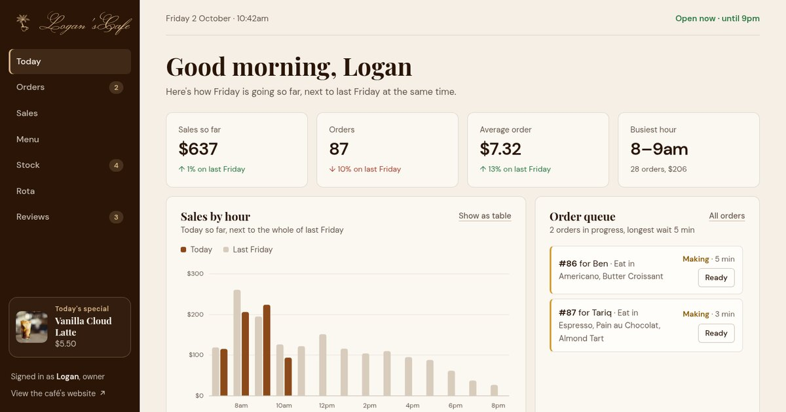

<div align="center">


# Logan'sCafe Dashboard

### The café, from behind the counter.

[](https://madebymyst.github.io/logans-cafe-dashboard/)

</div>

> **This is a concept project.** Logan'sCafe isn't a real café. The orders, sales, stock, staff and reviews are demo data, made to show dashboard design.



The owner's side of [Logan'sCafe](https://madebymyst.github.io/logans-cafe/), designed and built by [MadeByMyst](https://madebymyst.github.io/). It uses the same colours, type and buttons as the café's website, and answers what the owner checks through the day: how today is going, what's waiting at the counter, what to order and who's on shift.

## What's on it

- **Today:** sales so far against the same day last week, sales by hour, a live order queue, best sellers, who's on shift, what's running low and the latest review
- **Orders:** every order through the till today, with a filter and search
- **Sales:** the last 7, 30 or 90 days, where the money comes from, best sellers and a heatmap of the busiest hours
- **Menu:** change prices, mark items as sold out and pick today's special
- **Stock:** fill levels, days left and delivery days, with a "mark as ordered" button
- **Rota:** this week's shifts, with today highlighted
- **Reviews:** the average rating, and replies to the reviews that need one

## How the demo data works

- Each day's orders come from a seeded random generator, so the numbers are the same every time you load the page.
- The dashboard follows the clock. Today's figures grow through the day, new orders join the queue, and before opening time it shows yesterday instead.
- Changes (prices, today's special, orders moved along, stock ordered, replies) are saved in your browser only.

## Simple and fast on purpose

- Plain HTML, CSS and JavaScript. No frameworks, no chart library, no build step.
- Charts are small SVGs drawn by the script. Each one can switch to a table, and they work with the keyboard as well as the mouse.
- Chart colours were checked for colour-blind separation, and status (running low, order today) always comes with a word and an icon, not just a colour.
- Works on phones, tablets and desktops, and respects "reduce motion" settings.

## Files

| File | What it does |
|---|---|
| `index.html` | The page, with one section for each view |
| `styles.css` | Design tokens at the top (shared with the café's website), then each part, written mobile-first |
| `data.js` | The demo data: menu, opening hours, the order generator, stock, rota and reviews |
| `charts.js` | The charts: columns, ranked bars, a stacked bar, a heatmap and the shared tooltip |
| `script.js` | Builds each view, keeps the live parts moving and saves changes in the browser |

To run it locally, open `index.html` in a browser, or serve the folder:

```bash
python3 -m http.server
```

## Credits

| Asset | Source |
|---|---|
| Photos | [Unsplash](https://unsplash.com/) |
| Fonts | Playfair Display, DM Sans and Monsieur La Doulaise from [Google Fonts](https://fonts.google.com/) |

---

<div align="center">

Made by **[MadeByMyst (Shahab MD)](https://madebymyst.github.io/)**, front-end developer based in Oman.

[](https://www.instagram.com/_mystiqdev72/)
[](https://www.linkedin.com/in/mystique-x-9572b93a7/)

</div>
